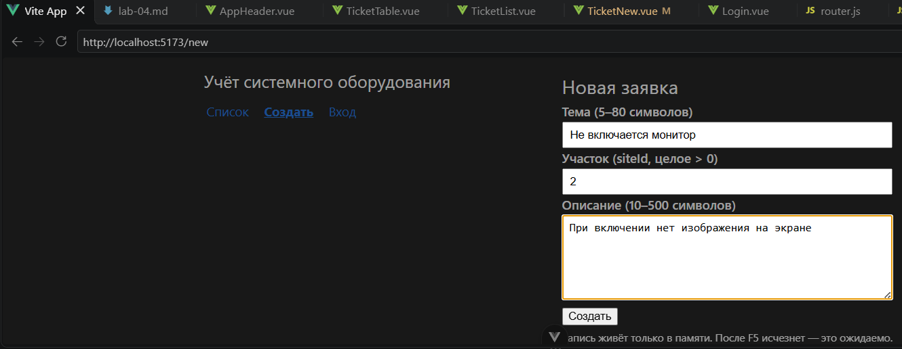
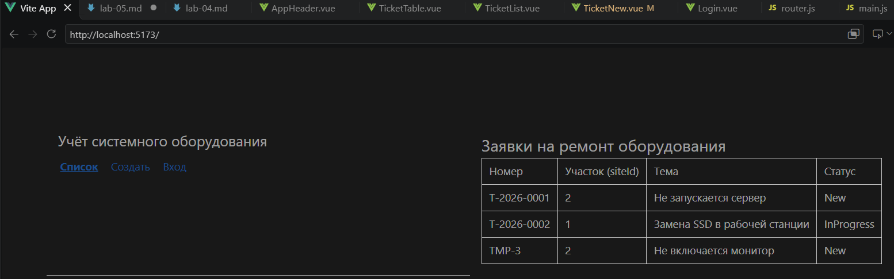
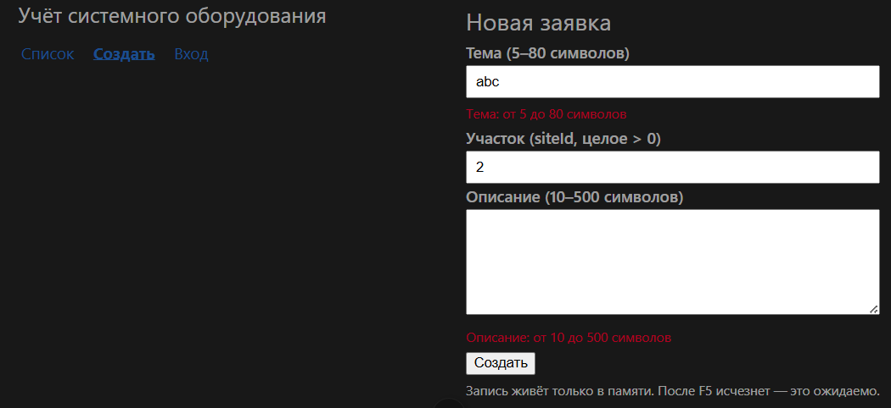
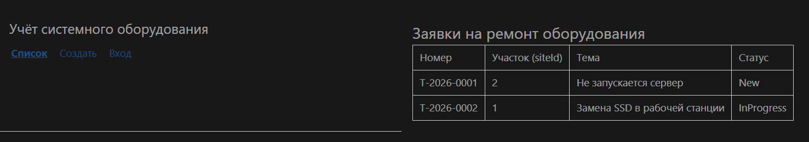

## Что сделано

- Форма связана с массивом через `v-model`, `siteId` хранится числом (`.number`).
- Форма отправляется через `@submit.prevent="onCreate"`.
- Добавлена проверка: `title` 5–80, `siteId` целое > 0, `description` 10–500.
- Новая запись добавляется в общий `ticketsStore.js` со статусом `New`.

## Три доказательства

| Проверка | Что делаю | Факт |
|---|---|---|
| Успех | тема «Не включается монитор», siteId 2, описание ≥ 10 | строка со статусом New появилась в списке |
| Отказ | тема `abc` | под полем ошибка, строка не добавилась |
| Память | F5 после успешного создания | добавленная строка исчезла |

**F5:** ожидаемо — сервера и БД пока нет, данные живут только в памяти браузера.

### Успех

### Отказ

### После F5

