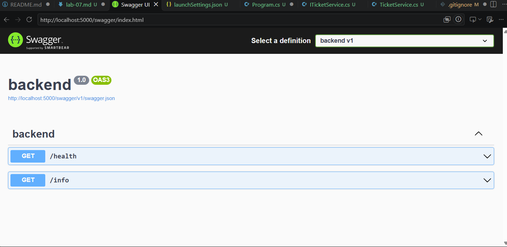
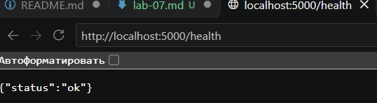
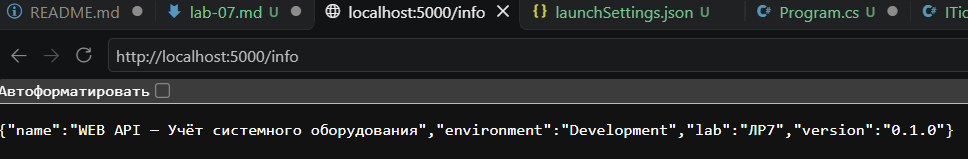
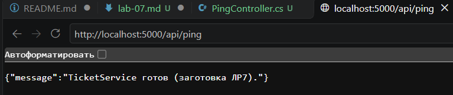

# Отчёт по лабораторной работе 7

## Тема

ASP.NET Core: каркас Web API.

## Что сделано

- Создан проект `backend/` рядом с `frontend/`.
- Сервер слушает `http://localhost:5000`.
- Swagger доступен на `/swagger` в режиме Development.
- Добавлены служебные адреса `/health` и `/info`.
- Созданы папки `Controllers`, `Services`, `Models`, `Data`.
- Сервис `TicketService` зарегистрирован через DI (в `Program.cs`).
- `.gitignore` исключает `bin/` и `obj/`.

## Адреса

| Адрес | Ответ |
|---|---|
| `http://localhost:5000/swagger` | страница Swagger |
| `http://localhost:5000/health` | 200, `{"status":"ok"}` |
| `http://localhost:5000/info` | JSON с именем, средой `Development`, пометкой `ЛР7` |
| `http://localhost:5000/api/ping` | `TicketService готов (заготовка ЛР7)` |

## DI

Сервис зарегистрирован через DI, чтобы контроллер не создавал реализацию через `new`.
Это позволяет позже заменить хранение в памяти на PostgreSQL, не переписывая контроллер.

## Чеклист «/health ≠ создание»

| Утверждение | да/нет |
|---|---|
| /health возвращает 200 без тела заявки | да |
| /health не принимает title, siteId, description | да |
| Успешный /health не доказывает работу POST | да |
| Создание главного объекта относится к ЛР8 | да |
| README прямо объясняет это различие | да |
| Swagger и /health проверены отдельно | да |

## Скриншоты

- 
- 
- 
- 