# Отчёт по лабораторной работе 8

## Тема
REST: создание, чтение, назначение и статус.

## Маршруты API

| Метод | Путь | Успех | Ошибки |
|---|---|---|---|
| POST | /api/tickets | 201 | 400 |
| GET | /api/tickets | 200 [] | — |
| GET | /api/tickets/{id} | 200 | 404 |
| PATCH | /api/tickets/{id}/assignee | 200 | 404 |
| PATCH | /api/tickets/{id}/status | 200 | 400 / 404 / 409 |

Все маршруты успешно зарегистрированы и отображаются в Swagger:

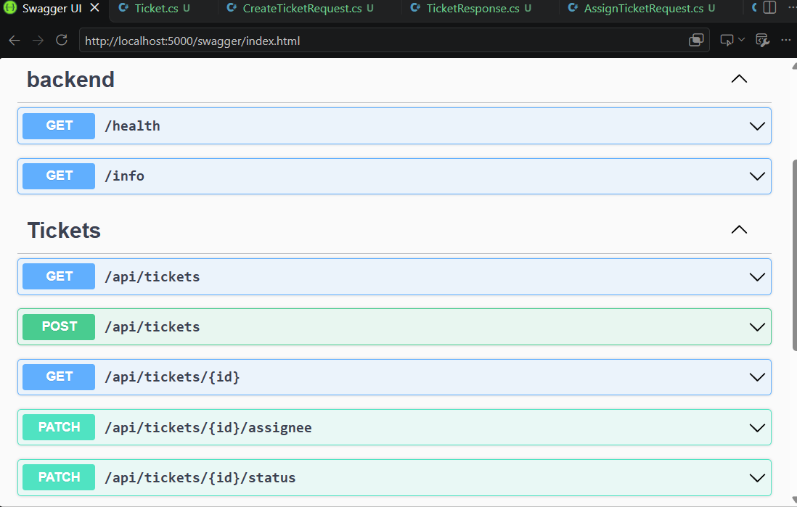

## Проверки в Postman

Коллекция запросов сохранена в репозитории: `docs/api-collection/tickets.postman_collection.json`.

### 1. Успешное создание (201)
При отправке валидных данных сервер возвращает `201 Created`, сам генерирует `id`, `number` и устанавливает статус `New`.

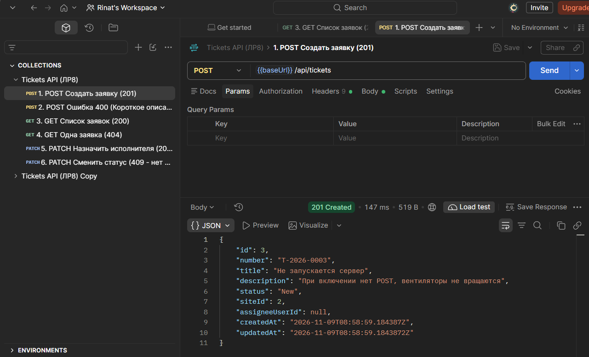

### 2. Ошибка валидации (400)
При отправке некорректных данных (например, `title: "abc"` или пустое описание) сервер возвращает `400 Bad Request` с понятным сообщением.

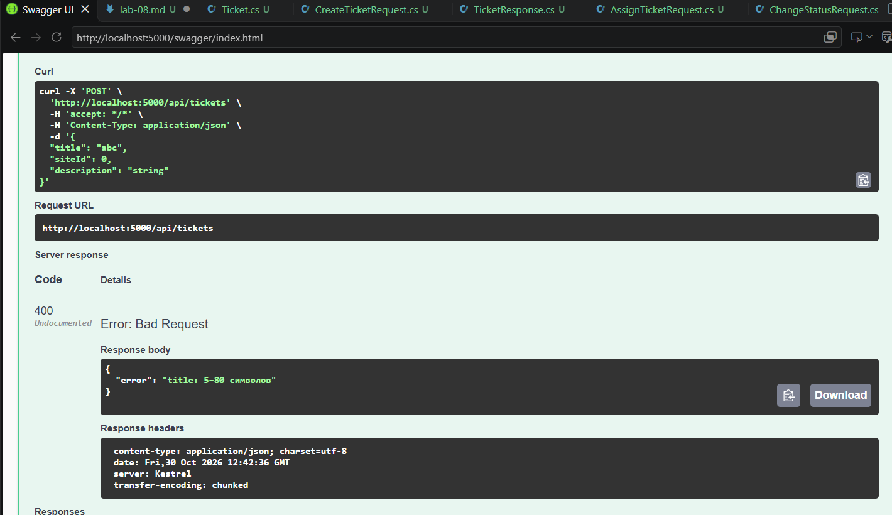

### 3. Получение списка (200)
Возвращается массив всех заявок. Если заявок нет, вернётся `200` и пустой массив `[]`.

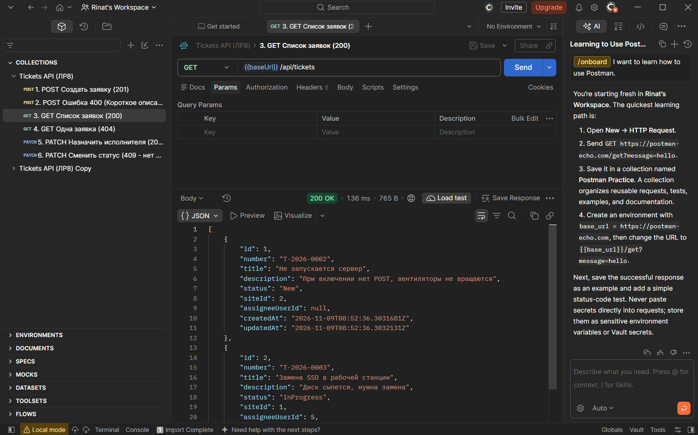

### 4. Получение одной заявки (200)
Запрос конкретной заявки по её `id` возвращает объект.

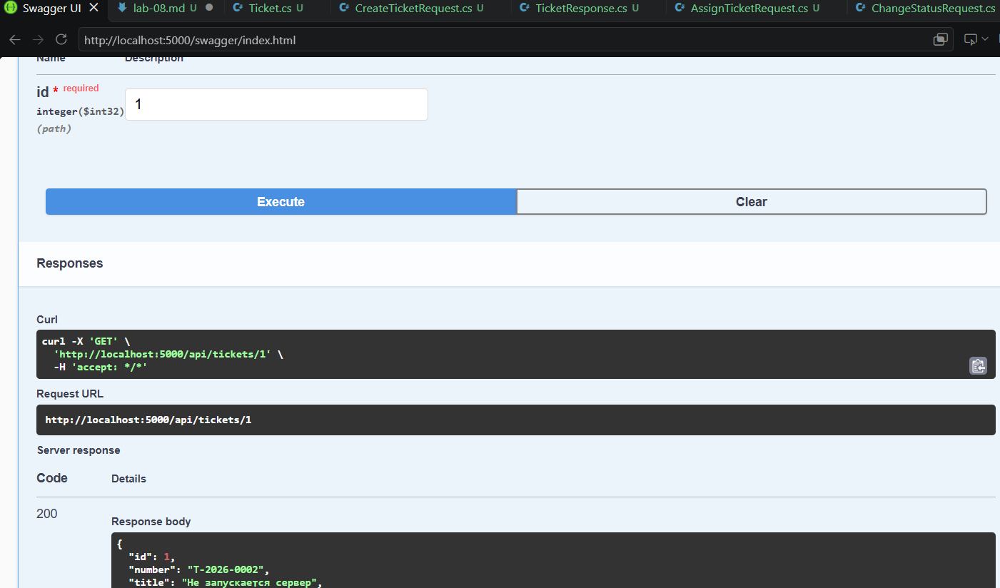

### 5. Ошибка 404 (Не найдено)
Запрос несуществующей заявки (например, с `id=999`) возвращает `404 Not Found`.

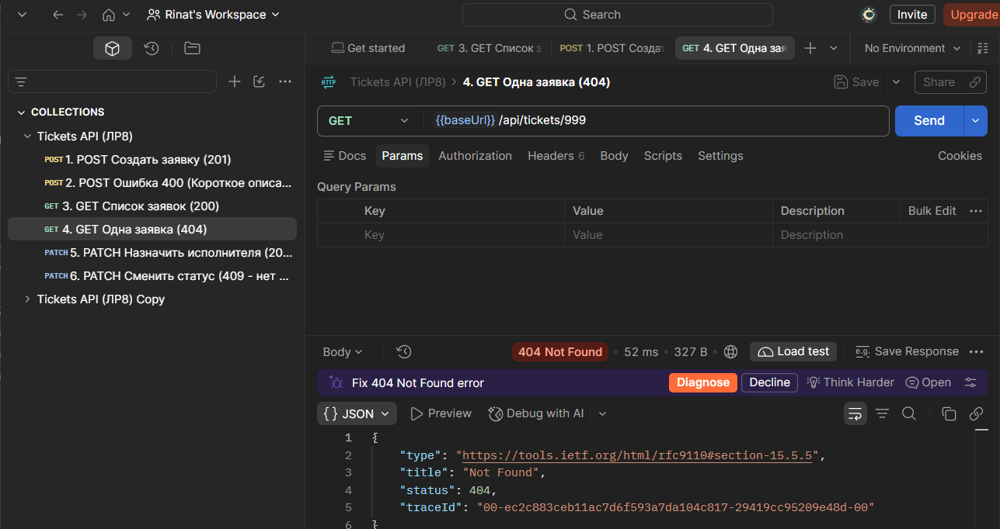

### 6. Назначение исполнителя (200)
Маршрут `PATCH /assignee` успешно обновляет поле `assigneeUserId`.

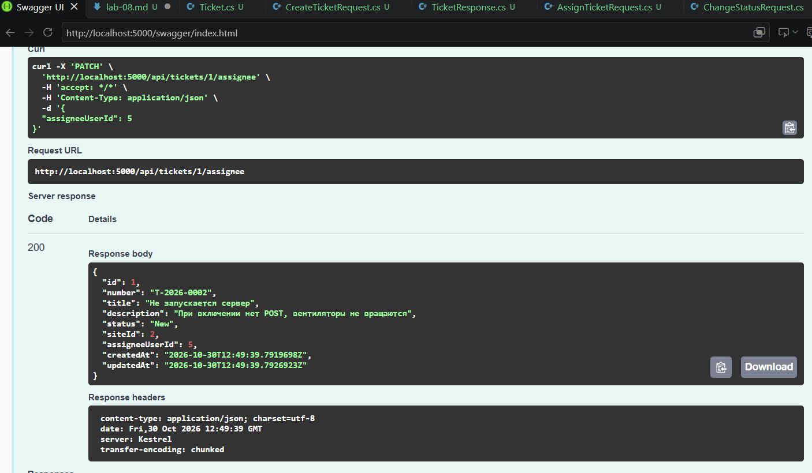

### 7. Смена статуса (409 и 200)
- Если попытаться перевести заявку в `InProgress` **без назначенного исполнителя**, сервер вернёт `409 Conflict` (правило бизнес-логики).
- Если исполнитель назначен, смена статуса проходит успешно (`200 OK`).

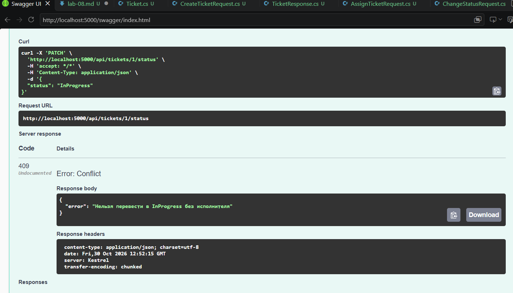
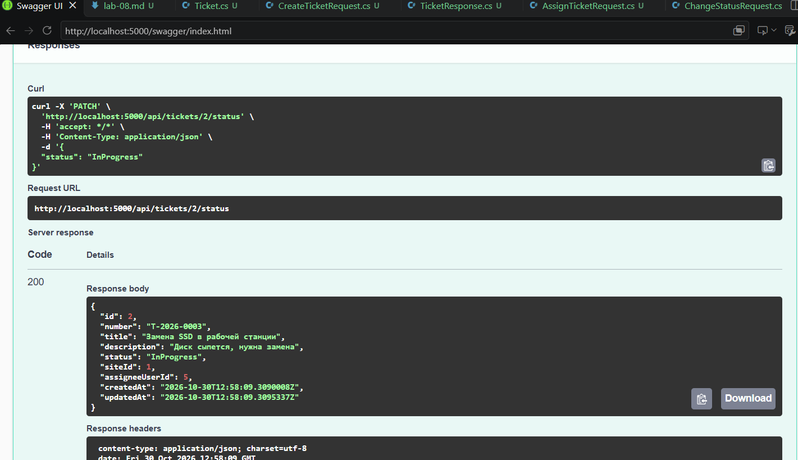

---

## Лог неожиданной ошибки (500)

Временно в код было добавлено учебное исключение `throw new InvalidOperationException(...)`.
При отправке валидного POST-запроса сервер вернул клиенту безопасный `ProblemDetails` (код 500) **без stack trace и путей**:

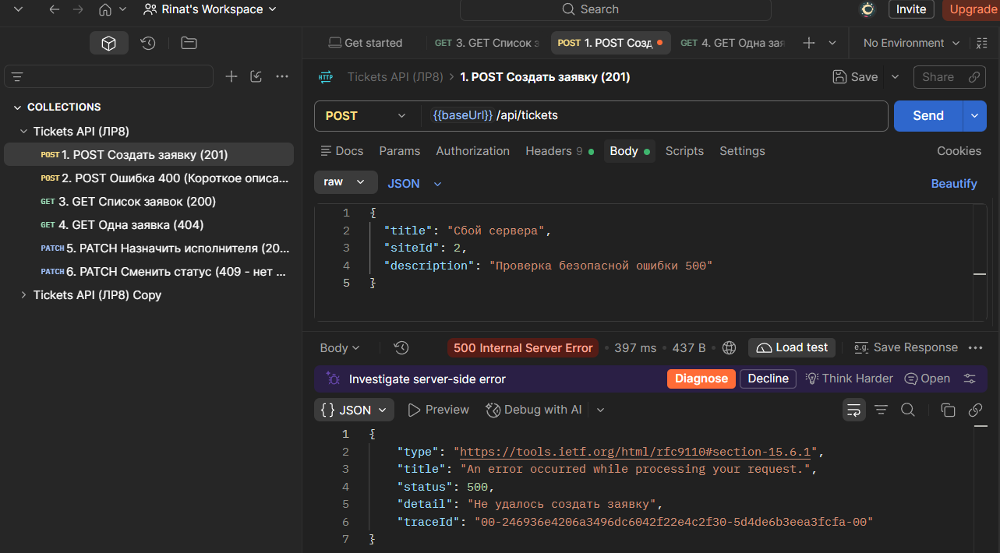

При этом в терминале сервера появилась одна понятная строка лога с типом ошибки:

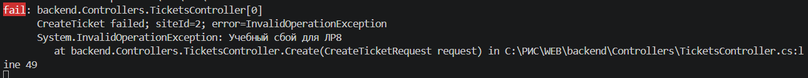

*Учебный сбой был удалён из кода перед коммитом.*